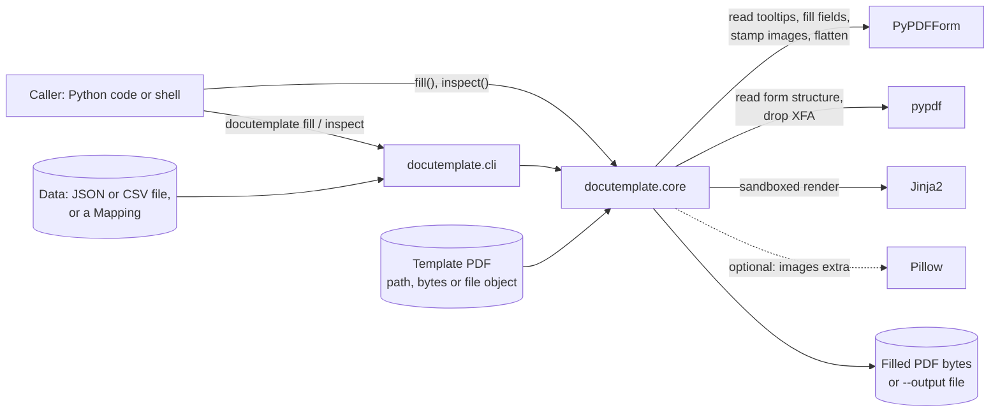

# docutemplate architecture

docutemplate is a small, stateless Python library and command-line tool. It fills PDF forms
from Jinja templates stored in each field's tooltip. It is not a service: it runs in the
caller's process and holds no state between calls.

## Diagram

## Components

| Module | Role |
| --- | --- |
| `src/docutemplate/core.py` | `fill` and `inspect`: read each field's tooltip, render it with a sandboxed Jinja environment against the caller's data, and write the value (text, checkbox states, radios, choices, images) with optional flatten. Handles hierarchical fields and removes XFA data from hybrid forms. |
| `src/docutemplate/cli.py` | `docutemplate fill FORM DATA -o OUT [--flatten] [--row N] [--no-strict]` and `docutemplate inspect FORM`. Loads JSON or one CSV row. Exit code 0 on success, 2 on error. |
| `src/docutemplate/errors.py` | `DocutemplateError` hierarchy, turned into CLI errors. |

## Services, routes, queues

None. There is no server, HTTP route, queue, scheduler, IPC or bus action. The only entry
points are the Python API (`docutemplate.fill`, `docutemplate.inspect`) and the CLI.

## Data stores

None. Input is read from files or memory and output is returned as bytes or written to the
path given with `-o`. Nothing is cached, logged or persisted, and no secrets are stored.

## External dependencies

| Dependency | Use |
| --- | --- |
| PyPDFForm `>=3.5,<3.6` | Field discovery, filling, image stamping, flatten. |
| pypdf `>=5,<7` | Direct form structure access and XFA removal. Pinned below 7, which broke image stamping. |
| Jinja2 `>=3.1.6,<4` | Template rendering in a sandboxed environment, so tooltip templates cannot run arbitrary code. |
| Pillow `>=10` (optional, `images` extra) | Image stamping. |

No network calls are made at runtime.

## Trust boundary

Template PDFs and their tooltips are untrusted input. Tooltips are rendered only through
Jinja's sandbox, with strict undefined variables by default (`--no-strict` relaxes this).

## Distribution

- **Package:** a Python package (`docutemplate`, MIT, Python 3.11+) built with setuptools as
  an sdist and wheel; a PyPI release is planned. It runs wherever it is installed and has no
  hosted service.
- **Local gate:** `scripts/check.sh` runs ruff, `ruff format --check`, strict mypy and pytest
  (coverage floor 98%); `scripts/ci-local.sh` adds the cyclomatic-complexity ceiling
  (`docs/quality/baseline.md`). There are no GitHub Actions workflows.
